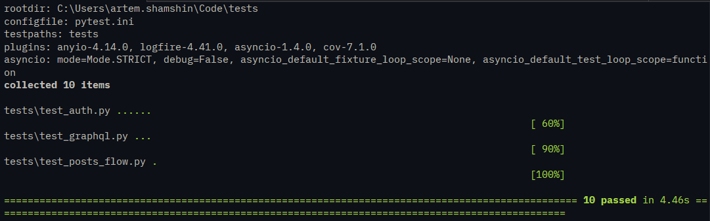
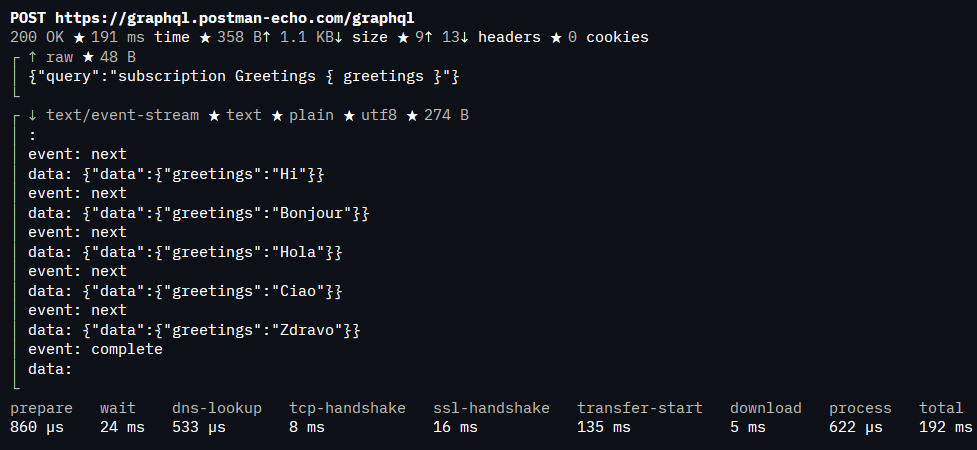

Домашнее задание: автоматизация тестирования REST и GraphQL API

Проект на Python: pytest + requests.

API
REST: https://playground.nileslabs.com/api/v1
GraphQL: https://graphql.postman-echo.com/graphql

Сценарии

| Сценарий | Что проверяется |
|----------|-----------------|
| `tests/test_posts_flow.py` | REST: `POST /posts` -> id -> `PATCH /posts/{id}` -> `GET /posts/{id}`; HTTP status, id, изменённый title, неизменённый body |
| `tests/test_auth.py` | Авторизация: `POST /auth/login` -> access_token -> `GET /auth/me` с Bearer; негативы: без токена, неверный токен, неверные логин/пароль |
| `tests/test_graphql.py` | GraphQL: query hello и mutation CreatePerson; HTTP 200, data, поля id/name/age, отсутствие errors |
| `postman/rest_graphql_homework.postman_collection.json` | Subscription `Greetings { greetings }` с `Accept: text/event-stream` |

Запуск

```
pip install -r requirements.txt
pytest
```

Результаты


Прогон тестов: 10 passed


Subscription Greetings { greetings } в Postman CLI: SSE-события Hi, Bonjour, Hola, Ciao, Zdravo
